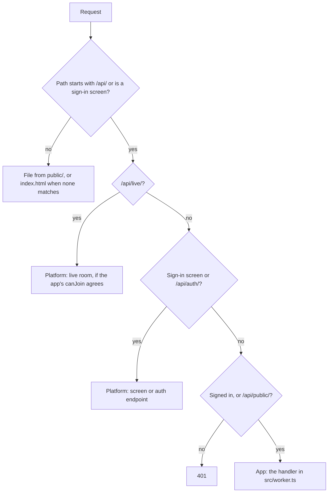
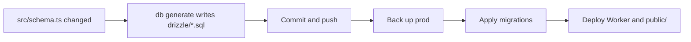

# How it works

What the platform gives an app, what the app writes itself, and how the two fit together.

## At a glance

| Area | The platform provides | The app writes |
| --- | --- | --- |
| **Config** | Validation, plus every cloud resource derived from it | `platform.jsonc` |
| **Pages and assets** | Serving them, and the sign-in screens | HTML, CSS, images and scripts in its frontend folder |
| **API** | Auth endpoints, sign-in checks, live rooms | One handler in `src/worker.ts` for its own `/api` routes |
| **Database** | Postgres per environment, auth tables, migration runner | Its tables in `src/schema.ts` |
| **Migrations** | `db generate`, and applying them at deploy | Commits the generated `drizzle/` folder |
| **Auth** | Accounts, sessions, email, teams, `/login` and friends | Nothing, or a stylesheet to restyle the screens |
| **Files, email, live** | `app.files`, `app.email`, `app.live` | Calls them from its handler |
| **Deploys** | Prod on push to main, a preview per PR, cleanup | Nothing |

## How the pieces fit

### An app is four things

```
my-app/
  platform.jsonc     what the app needs: name, hostname, database, auth, files, live
  public/            pages and assets, served as they are
  src/worker.ts      the app's API: one function that answers requests
  src/schema.ts      the app's tables
  drizzle/           migrations, generated from the tables; never hand-written
```

### A request



### A deploy



## Details

### Pages and assets

1. **Folder:** `frontend` in `platform.jsonc` names it, `public` in the demo.
2. **Served free:** files come straight from Cloudflare's asset store and never run the Worker.
3. **Single-page apps:** a path with no matching file gets `index.html`, so client-side routing works.
4. **No build step yet:** the platform deploys the folder as it is, so it must hold finished files.
5. **Worker first:** `/api/*` and the sign-in screens always go to the Worker, even if a file has the same path.

### Sign-in screens

1. **Paths:** `/login`, `/signup`, `/forgot` and `/reset`, rendered by the platform when `auth` is on.
2. **Restyling:** `defineApp(handler, { screens: { stylesheet: "/auth.css" } })` loads the app's own CSS after the platform's.
3. **Replacing:** an app can build its own pages that call `/api/auth/*` directly instead.

### The app's API

1. **One handler:** `src/worker.ts` exports `defineApp(async (request, app) => Response)`.
2. **Routing:** the handler matches paths itself; the platform has no router.
3. **Private by default:** every `/api/*` path needs a signed-in user, except `/api/auth/`, `/api/public/` and `/api/live/`.
4. **`app`:** `db`, `auth`, `session()`, `requireUser()`, `files`, `email`, `live`, `env` and `waitUntil`, each created on first use.
5. **Errors:** a thrown `Response`, such as `requireUser()`'s 401, is sent as the answer.
6. **Forms:** cross-site form posts are refused before the handler runs.

### Tables and migrations

1. **App tables:** Drizzle `pgTable` definitions in `src/schema.ts`; pass them as `defineApp(handler, { schema })` for a typed `app.db`.
2. **Platform tables:** user, session, account, verification and the team tables, from `@celsoft/platform/schema`, included when `auth` is on.
3. **Linking:** app tables may reference platform ones, such as `user.id`.
4. **Helpers:** `id()` gives a `uuidv7()` primary key and `timestamps()` gives `created_at` and `updated_at`.
5. **Generate:** `npx @celsoft/platform db generate` compares both sets of tables with the last migration and writes the difference to `drizzle/`.
6. **Apply:** deploy applies new migrations under a lock, and stops before any change if `db generate` was not run.
7. **Previews:** each PR gets its own copy of the prod database, so migrations are tried there first.

### Live rooms

1. **On:** `"live": true` in `platform.jsonc`.
2. **Who joins:** the app's `canJoin(room, user, app)`; refused unless it says yes.
3. **Who sends:** the server with `app.live.publish(room, message)`, and browsers when `canSend` says yes.
4. **Browser:** `live()` from `/api/live/client.js`, or `@celsoft/platform/live` in a bundled app.
5. **Storage:** none beyond the last 500 messages for catching up; the app saves what it wants kept.

### Deploys

1. **Prod:** a push to main backs up the database, applies migrations, then deploys the Worker and assets.
2. **Preview:** each PR gets its own Worker, hostname, database copy and file space.
3. **Cleanup:** closing a PR deletes its preview, and a daily sweep catches any that were missed.
4. **Same everywhere:** CI and a local `npx @celsoft/platform deploy` run the same steps.
