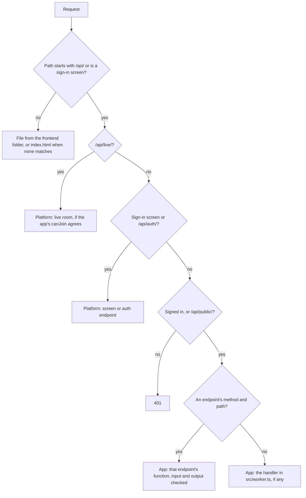
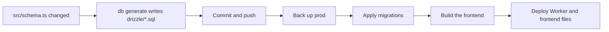

# How it works

What the platform gives an app, what the app writes itself, and how the two fit together.

## At a glance

| Area | The platform provides | The app writes |
| --- | --- | --- |
| **Config** | Validation, plus every cloud resource derived from it | `platform.jsonc` |
| **Pages and assets** | Running the app's build, serving the output, the sign-in screens | Its pages, plain or built with any tool such as Vite |
| **API** | Auth endpoints, sign-in checks, live rooms, routing and checking typed endpoints | Endpoints in `src/worker.ts`: Zod schemas plus a function each |
| **Database** | Postgres per environment, auth tables, migration runner | Its tables in `src/schema.ts` |
| **Migrations** | `db generate`, and applying them at deploy | Commits the generated `drizzle/` folder |
| **Auth** | Accounts, sessions, email, teams, `/login` and friends | Nothing, or a stylesheet to restyle the screens |
| **Files, email, live** | `app.files`, `app.email`, `app.live` | Calls them from its handler |
| **Deploys** | Prod on push to main, a preview per PR, cleanup | Nothing |
| **Tests** | `@celsoft/platform/testing`: the real runtime on a local Postgres, files in memory and captured email | Its tests, calling endpoints as people it signs up |

## Where each file comes from

| Kind | Files | In git | Who edits |
| --- | --- | --- | --- |
| **Written by you** | `platform.jsonc`, `src/`, `public/`, `package.json` | Yes | You |
| **Generated, committed** | `drizzle/`, `.github/workflows/platform.yml` | Yes | Nobody; regenerate instead |
| **Generated, ignored** | `.platform/`: the browser client, and the deploy's temporary files | No | Nobody; written on install, `dev` and deploy |
| **Generated block** | The `@celsoft/platform` block in `AGENTS.md`, pointing agents at the package's skills | Yes | You, outside the block; the platform rewrites the block on install |
| **Skill copies** | `.claude/skills/celsoft-platform*/`, the package's skills for Claude Code | No | Nobody; `skills` and every install rewrite them |
| **From the package** | Runtime, auth tables, sign-in screens, live client | No, in `node_modules` | Nobody; upgrade the package |

## How the pieces fit

### An app's files

```
my-app/
  platform.jsonc                    yours: what the app needs, such as name, hostname, database, auth
  public/ or index.html, src/...    yours: pages and assets, plain or built
  src/worker.ts                     yours: the app's API, typed endpoints
  src/schema.ts                     yours: the app's tables
  drizzle/                          generated by `db generate`; commit, never edit
  .github/workflows/platform.yml    generated by `init`; commit, never edit
  .platform/                        generated on install, `dev` and deploy; ignored, never edit
```

### A request



### A deploy



## Details

### Generated and provided files

1. **Your files:** `platform new` writes them once, after `npm install @celsoft/platform` and `platform skills`, then they are yours; the platform never rewrites them, except `upgrade`, which updates `platform.jsonc` to a new shape and keeps its comments, and adds what a newer `new` writes that the app lacks, such as a test script.
2. **Migrations:** `db generate` writes them; an edited migration that already ran never runs again, so databases created before and after the edit end up different.
3. **Workflow:** `init` writes it; CI stops if it differs from what the installed version writes, so an edit fails the next deploy until `init` is rerun.
4. **Temporary:** `deploy` and `dev` write the Wrangler config, entry module, a stub standing in for Better Auth's unused Kysely adapter, and secrets, then delete them; they are gitignored. The deployed Worker is minified, so it starts faster.
5. **Package:** everything else runs from `node_modules`, so a new version reaches the app with no file changes.
6. **Upgrading:** bump the package, run `init` and `db generate`, and commit what changed; CI stops with the fix when either was skipped.
7. **Customizing:** done through options the package reads, such as `screens.stylesheet` or `live.canJoin`, never by editing a generated file.

### Pages and assets

1. **Folder:** `frontend` in `platform.jsonc` names it: plain files, or a build's output such as `dist` in the demo.
2. **Served free:** files come straight from Cloudflare's asset store and never run the Worker.
3. **Single-page apps:** a path with no matching file gets `index.html`, so client-side routing works.
4. **Build:** when `package.json` has a `build` script, every deploy runs it first; a failed build stops the deploy.
5. **Any tool:** the output is static, so any tool works; pages search engines must read without JavaScript are rendered at build time, by tools such as SvelteKit's static adapter or Astro, or per request as server pages.
6. **Local:** when `package.json` has a `dev` script, `platform dev` runs it beside the local Worker; with the package's Vite plugin, `plugins: [platform()]` from `@celsoft/platform/vite`, Vite forwards the Worker's paths and edits reload instantly.
7. **Worker first:** `/api/*`, the sign-in screens and every path a server page claims always go to the Worker, even if a file has the same path.
8. **What the server renders:** only content identical for everyone allowed to see it; anything that depends on who is looking or what they have done (sign-in state, saved choices, checkmarks, drafts, admin screens) is added by the browser after the page loads. A page can mix both, such as a checklist rendered with every box unchecked whose visitor's own ticks the browser fills in. A page's access gate decides who gets it, never what it says, so one kept copy serves everyone who passes.
9. **Server pages:** `pages: [page({ path: "/print", routes: { "/:id": ... } })]` in `defineApp` claims `/print` and everything below it, a last `*name` segment such as `"/*path"` matches any depth below it, and `page({ path: "/", routes: { "/": ... } })` claims the root alone; each route returns HTML, and every other path is still a static file. A route may add `cache: true`, and every visitor then shares a copy the edge keeps for 60 seconds, or `seconds`, until `app.cache.invalidate(path)` or `app.cache.clear()` empties it within a second; the API is never cached. A route declares who may read it, `access: { point, level }`, `{ level }` or `"anon"`, checked before the handler and the cache; refused and missing pages get one 404 that offers sign-in when signed out, share links and API tokens count, and the handler cannot ask who is looking: `app.session()`, `app.requireUser()` and `app.access` throw on a page.

### Sign-in screens

1. **Paths:** `/login`, `/signup`, `/forgot` and `/reset`, rendered by the platform when `auth` is on.
2. **Restyling:** `defineApp(handler, { screens: { stylesheet: "/auth.css" } })` loads the app's own CSS after the platform's.
3. **Replacing:** an app can build its own pages that call `/api/auth/*` directly instead.
4. **Invite-only:** the first account is saved as the owner, and after it only invited addresses may sign up; the owner and admins invite at `/invites`, and an organization invitation or a share to an address also lets it in. `"auth": { "signup": "open" }` lets anyone sign up.

### The app's API

1. **Endpoints:** `src/worker.ts` exports `defineApp(handler, { endpoints })`; each endpoint is `endpoint({ method, path, input, output }, async (input, app) => output)`.
2. **Types:** the input and output are Zod schemas, the only types an app writes.
3. **Inputs:** `:name` in the path, the query, and a JSON body merge into one input object, with URL strings converted to the schema's types.
4. **Checks:** bad input is a 400 with `{ error }`; an output that does not match its schema is a 500, logged.
5. **Failing:** `throw new EndpointError(404, "not found")` sends that status with `{ error }`.
6. **Browser:** a bundled frontend imports `call` from `.platform/client.ts` and calls `call("listItems", {})`, typed from the endpoints.
7. **Handler:** optional; it takes every request no endpoint answers, for uploads, downloads and streaming.
8. **Private by default:** every `/api/*` path needs a signed-in user, except `/api/auth/`, `/api/public/` and `/api/live/`.
9. **`app`:** `db`, `auth`, `session()`, `requireUser()`, `files`, `email`, `live`, `cache`, `env` and `waitUntil`, each created on first use.
10. **Errors:** a thrown `Response`, such as `requireUser()`'s 401, is sent as the answer.
11. **Forms:** cross-site form posts are refused before the handler runs.

### Tables and migrations

1. **App tables:** Drizzle `pgTable` definitions in `src/schema.ts`; pass them as `defineApp(handler, { schema })` for a typed `app.db`.
2. **Platform tables:** user, session, account, verification and the team tables, from `@celsoft/platform/schema`, included when `auth` is on.
3. **Linking:** app tables may reference platform ones, such as `user.id`.
4. **Helpers:** `id()` gives a `uuidv7()` primary key and `timestamps()` gives `created_at` and `updated_at`.
5. **Generate:** `npx @celsoft/platform db generate` compares both sets of tables with the last migration and writes the difference to `drizzle/`; `--custom <name>` writes an empty migration for the app's own SQL, such as moving data, the one `drizzle/` file the app edits; when drizzle-kit asks whether something was renamed, it stops and lists the `--rename <old>=<new>` and `--create <new>` flags that answer it.
6. **Apply:** deploy applies new migrations under a lock, and stops before any change if `db generate` was not run.
7. **Platform SQL:** after migrations, deploy and `dev` install the platform's access triggers and functions and write the app's static points, so no request ever does.
8. **Previews:** each PR gets its own copy of the prod database, so migrations are tried there first.

### API tokens

1. **On:** `"auth": { "apiTokens": true }` in `platform.jsonc`.
2. **Making:** people make, list and revoke their own at `/tokens`, choosing a name, a lifetime of up to 365 days (90 by default) and a level cap.
3. **Using:** scripts send `Authorization: Bearer <token>` to `/api/`; the request runs as the token's owner, with every access check capped at the token's level, an endpoint declared `{ level }` refusing a token capped below it, and a `read` token only reads.
4. **Never on auth:** tokens are ignored on `/api/auth/*` and refused on `/mcp`.
5. **Limits:** each token has its own allowance of `rateLimit` requests a minute, spent before it is looked up; a bad token also spends from its sender's address, so fake tokens cannot each get a fresh allowance.

### MCP

1. **On:** `"mcp": true` in `platform.jsonc`, with auth on.
2. **Tools:** each endpoint with `serve: ["mcp"]` or `serve: ["api", "mcp"]` is a tool named after the endpoint, described by its `description` and input schema.
3. **Connecting:** an AI client such as Claude is given `https://<hostname>/mcp`; it registers itself, sends the person to `/login` and `/consent`, and gets a token.
4. **As the user:** every call runs with `app.requireUser()` returning the person who approved the client, and gets the same control point checks the API does.
5. **Errors:** bad input, `EndpointError` and other failures come back as tool errors with a message, so the AI can correct itself.

### Access

1. **On:** `"access": true` in `platform.jsonc`, with auth on.
2. **Control points:** the app creates a point for each resource it wants to gate with `app.access.create(id, { parent, inherit })`; the creator gets `manage`, and fixed sections are static points declared in `defineApp`.
3. **Levels:** `read`, `create`, `write`, `delete`, `manage`, from grants to people, emails, teams, organizations and Everyone, links, and an organization's Admins team; each principal counts its nearest grant up the inherited parents, and the highest wins.
4. **Checks:** every endpoint and page route declares `access: { point, level }`, `{ level }` or `"anon"`, grants may go to `{ owner: true }`, the app's owner whoever that is at the time, hand-written routes call `app.access.check`, and lists filter with `app.access.readable`; anything short is a 404.
5. **Sharing:** a new grant to a person emails them a link into the app; a link token in the page's `#link=` fragment travels with every `call()`, and is kept as a cookie so downloads count it too.
6. **Rules:** every case is a row in [access-rules.md](access-rules.md), each with its own test.

### Organizations

1. **On:** `"auth": { "organizations": true }` in `platform.jsonc`.
2. **The platform's own:** organizations, teams, members and invitations through `app.organizations` and `/api/platform/`; Better Auth's organization plugin is not used.
3. **No roles:** each organization's built-in Admins team gets `manage` on everything under it, and its creator is the first admin; every other permission is a control point grant.

### Live rooms

1. **On:** `"live": true` in `platform.jsonc`.
2. **Who joins:** the app's `canJoin(room, user, app)`; refused unless it says yes.
3. **Who sends:** the server with `app.live.publish(room, message)`, and browsers when `canSend` says yes.
4. **Browser:** `live()` from `/api/live/client.js`, or `@celsoft/platform/live` in a bundled app.
5. **Storage:** none beyond the last 500 messages for catching up; the app saves what it wants kept.
6. **Message types:** `live: { message: schema }` checks every message, from browsers and `publish`, against a Zod schema; a room with several kinds of message uses `z.discriminatedUnion("type", [...])`.

### Testing

1. **Real runtime:** `testApp(app)` runs the app's own code through the platform's routing, access checks and auth, so a test passes only when the deployed endpoint would.
2. **Local stand-ins:** a Postgres 18 database of its own, migrated from `drizzle/`; files in memory; email kept in `t.emails`; live room messages in `t.published`.
3. **People:** `t.signUp(email)` makes a person, and `t.as(person).call("listItems", {})` calls an endpoint as them.
4. **Postgres:** from the app's `embedded-postgres` dev dependency, so `npm install` provides it, then `npm test` runs.

### Deploys

1. **Prod:** a push to main backs up the database, applies migrations, then deploys the Worker and assets.
2. **Preview:** each PR gets its own Worker, hostname, database copy and file space; the run says `live at` and posts the link only once the hostname answers over HTTPS.
3. **Cleanup:** closing a PR deletes its preview, and a daily sweep catches any that were missed.
4. **Same everywhere:** CI and a local `npx @celsoft/platform deploy` run the same steps.
5. **Own resources only:** the platform changes or deletes only resources carrying a name it makes for the app; [design.md](design.md#7-resource-identity) lists every name.
6. **Watching speed:** previews send `Server-Timing` on every response; prod logs it for one request in 100; `db stats` lists the costliest queries, and `db run <file> --pr <n>` loads test data into a preview.
